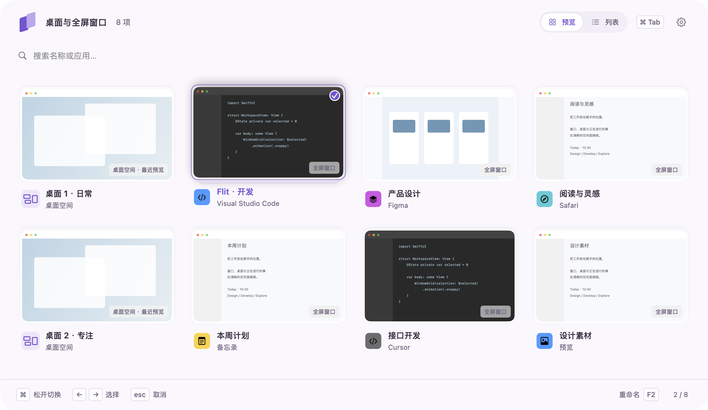
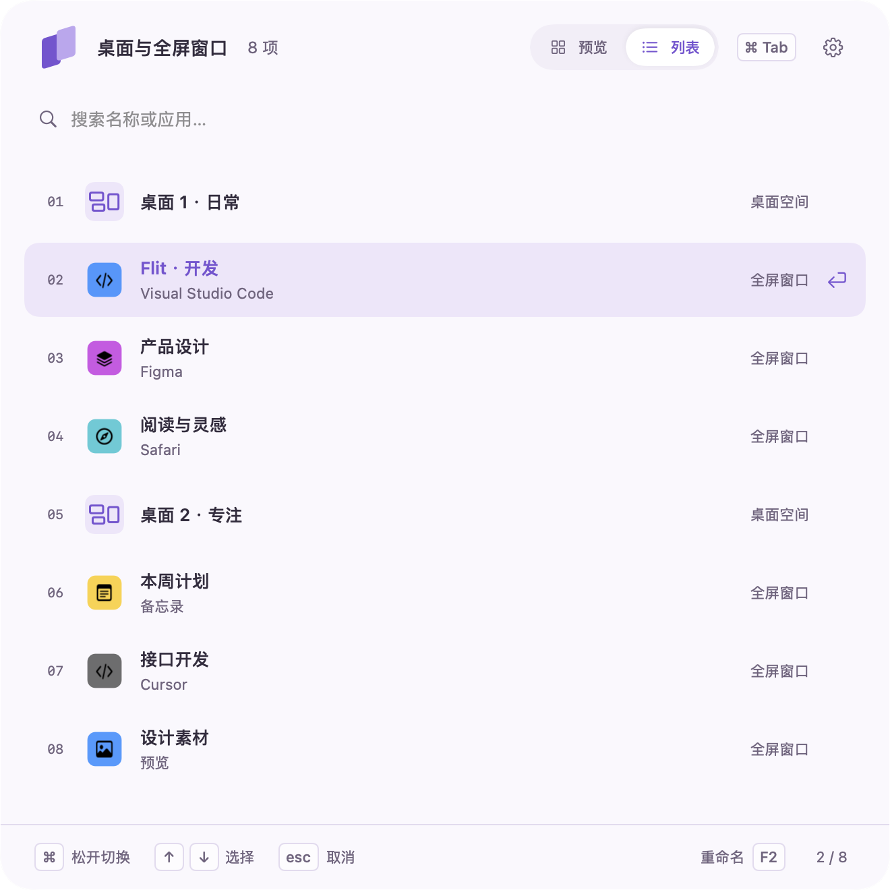
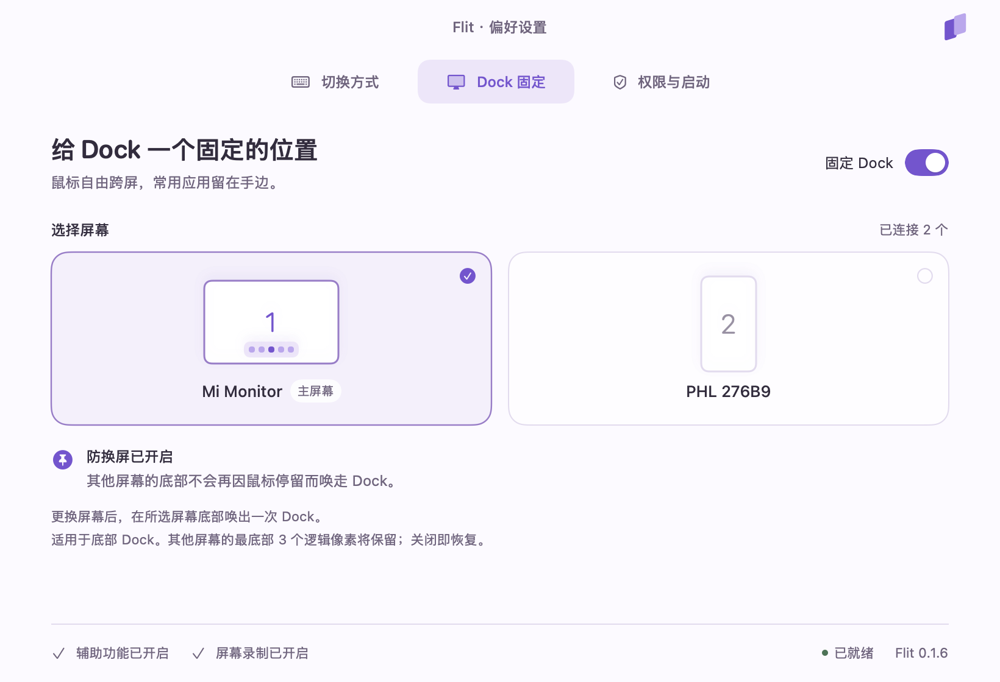

<p align="center">
  
</p>

**Flit** 是一个原生 macOS 菜单栏应用，让熟悉的 **⌘Tab** 在桌面空间与全屏窗口之间切换。成功切换后，目标自动来到首位，下次更容易回到它。

6 个全屏窗口 + 2 个桌面，就是 **8 个选项**。桌面里的普通应用窗口不会单独列出。



*本文界面图由 Flit 0.1.6 的实际 SwiftUI 视图渲染，窗口内容为演示数据。点击图片可查看大图。*

## 开始使用

当前提供源码构建，产物为本机试用版本。需要 Apple Command Line Tools 和 Python 3；构建目标为 macOS 14+，已验收环境为 Apple Silicon / macOS 27.0.1，其他系统版本尚未逐一验证。

在项目根目录执行：

```sh
zsh scripts/build.sh release
open build/Flit.app
```

首次运行会打开偏好设置。在「权限与启动」中完成授权后，就可以按住 **⌘**、按 **Tab** 选择、松开 **⌘** 切换。

- **辅助功能（必需）**：读取空间中的窗口、响应全局快捷键、切换目标；开启 Dock 固定时也使用此权限。
- **屏幕录制（可选）**：显示窗口与桌面预览。未开启时，仍可按名称与图标切换。

应用使用本地临时签名，尚未提供 Developer ID 签名、公证或通用架构安装包。**如需移动应用，请在最终放置位置完成授权**；重编译或移动后，macOS 可能要求重新授权。更多说明见[构建与权限排查](docs/development.md#构建与签名)。

## 顺手的切换方式

### 最近用过的，排在前面

通过 Flit 成功切换的目标会移到第一位，原来的项目依次后移，并保持相对顺序。再次轻按 **⌘Tab** 默认选择第二项，可以在最近两个空间之间往返。

选择过程中顺序保持稳定；取消或切换失败不会置顶。最近使用顺序保留到 Flit 退出，重新启动后从系统空间顺序开始，首次打开时将当前空间放到首位。

### 看预览，也可以只看名称

「预览」用网格展示画面与名称；「列表」用更紧凑的面板展示同一组空间，两种模式共用排序。通过窗口焦点直接到达目标空间，无需弹出 Mission Control，也不会依次播放经过中间空间的横向切换动画。

<p align="center">
  
</p>

### 用自己的名字和快捷键

选中项目后按 **F2**，或使用右键菜单中的「重命名」，就能把它改成「开发」「阅读」等容易辨认的名称；也可以恢复原标题。别名仅用于 Flit，不会修改其他应用的窗口标题。

在偏好设置「切换方式」中点击快捷键框，即可录入包含 **⌘ / ⌥ / ⌃** 的组合键。系统保留的组合键可能无法接管。

| 操作 | 默认按键或入口 |
| --- | --- |
| 打开并向后选择 | 按住 `⌘`，连按 `Tab` |
| 反向选择 | 按住 `⌘ ⇧`，按 `Tab` |
| 切换到选中目标 | 松开 `⌘` |
| 取消本次选择 | `Esc` |
| 搜索并停留在面板中 | 菜单栏 →「打开切换器」，输入名称或应用名 |
| 确认驻留模式中的选择 | 方向键选择后按 `Return`，或直接点击 |
| 重命名选中项目 | `F2`、右键菜单或面板底部「重命名」 |

暂停或退出 Flit 后，系统原来的 Command-Tab 会自动恢复。登录后启动可在「权限与启动」中设置。

## 给 Dock 一个固定的位置

多屏工作时，可以让 Dock 留在指定屏幕，避免鼠标停在另一块屏幕底部时把它唤走。



在偏好设置「Dock 固定」中打开开关，选择屏幕；更换目标后，在所选屏幕底部唤出一次 Dock 即可。目标屏幕断开时暂停固定，接回后恢复；关闭开关、暂停或退出 Flit 都会解除限制。

此功能默认关闭，适用于**底部 Dock、多个显示器及「显示器具有单独的空间」模式**。开启后会保留其他屏幕最底部 3 个逻辑像素，屏幕之间的上下接缝仍可通过。Flit 不修改显示器排列或系统空间设置。

## 本地数据与兼容范围

- **设置保存在本机。** 快捷键、显示方式、Dock 目标和别名存放于 `~/Library/Application Support/Flit/settings.json`；最近使用顺序仅保存在运行会话中。
- **预览不上传、不落盘。** 图像仅缓存在内存中，Flit 不采集音频。桌面预览是最近一次实际访问时的画面，并非未激活桌面的实时视频。
- **预览可能不可用。** 尚未访问的桌面、受保护内容和部分未激活全屏窗口会显示占位或图标，不影响按名称选择。
- **系统升级可能影响切换。** 空间枚举与切换使用部分非公开 macOS 接口；无需关闭 SIP 或注入系统进程。没有可激活窗口的空桌面使用手势兼容路径，要求鼠标位于目标屏幕，多显示器场景尚未完整验收。

## 遇到问题

**权限开关已开，Flit 仍显示未授权？**

先退出 Flit，在系统设置中移除失效的旧权限条目，重新添加当前位置的 `Flit.app`，再启动。系统身份验证需本人完成。如果辅助功能已授权，但快捷键仍未就绪，按应用提示检查「输入监控」。详见[权限排查](docs/development.md#权限排查)。

**需要检查运行状态或继续开发？**

查看[开发与诊断指南](docs/development.md)，其中包含只读诊断命令、原生界面渲染入口、实现边界与项目结构。第三方代码声明见 [ThirdPartyNotices.txt](Resources/ThirdPartyNotices.txt)。
